# Plan: groups and projects for agents

Status: proposal with three UI variations (mockups only), for the user to choose from. Nothing is built.

## Where we are

An agent has one `project`: a free-text name or tag (often a repo in the projects folder, like `api` or `work/isa`). That one string does five jobs today:

1. **The list**: the Agents list groups agents by it.
2. **The team**: one Lead per project, and the "team check" (is there a Dev and a reviewer?) is per project.
3. **Who can talk**: `@mentions` in an agent's chat only reach agents of the same project (api.rs). Mentions in an issue thread already reach any agent.
4. **Where an issue goes**: a new issue takes its assignee's project (tasks.rs); publishing, the mirror sync and planning use it as the repo.
5. **Where `@path` starts** in that agent's chat (its project folder when it names one).

An agent's working folder is not its project: it always runs in its own workspace, so several projects don't fight over a folder.

## The problem

The user has many backends and frontends. One project per agent means a frontend agent for each frontend, all doing the same thing, or one agent with the wrong project. They want: a **group** (a parent label, e.g. Dineout) with **several projects** inside (api, frontends, b2b, b2c, apps), agents that can work in one, several or all of them, know which they have, and use the right repo for issues.

## Two ways to think about it (the user's question)

- **(a) Agent has group + projects.** The group is a label on the agent; the agent lists its own projects. Simple, and an agent is self-describing. The group has no place of its own, so the same project list gets typed again and again, and nobody owns "the projects of Dineout".
- **(b) A group owns its projects, agents are put in it.** One place says what Dineout contains; agents inherit it. Cleaner for a team, but it is one more thing to create and manage, and an agent that should only see two of five projects needs an exception anyway.

The three variations are these two plus a hybrid. The screenshots show the agents list, create/edit agent, and creating an issue (picking among the agent's projects); B and C also show the group dialog.

## Variation A: agent-first (a)

The agent form gets **Group** (free text, with the groups in use as suggestions) and **Projects** (a multi-select of chips from the repos in the projects folder; the first is the main project). The list groups agents by group and shows each agent's project chips. A new issue limits Project to the assignee's projects (main one by default).

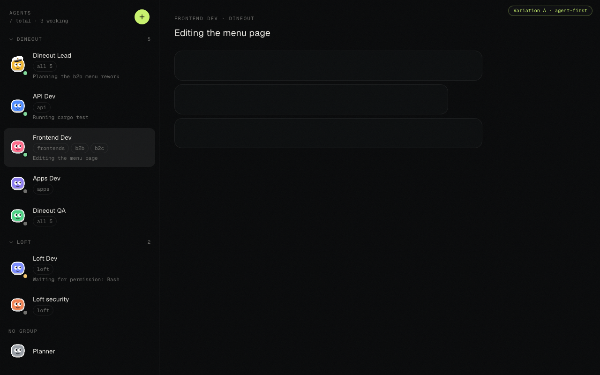
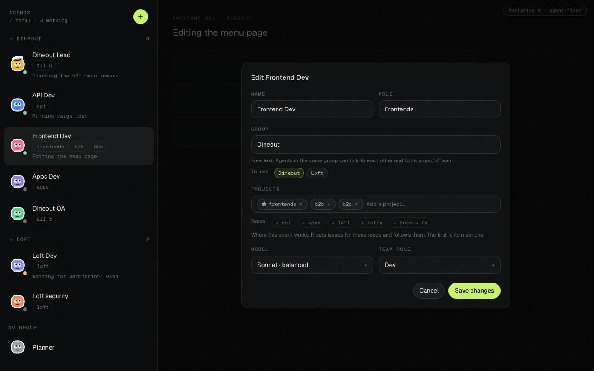
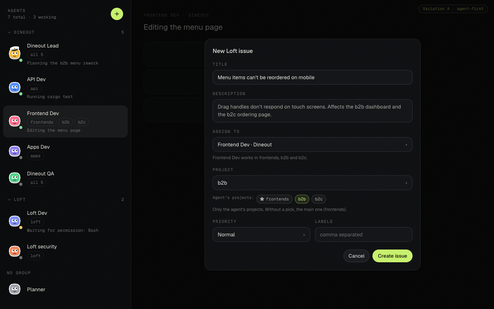

- Pros: smallest change; no new entity; exactly what the user described first; today's single project is just a list of one.
- Cons: the group's projects live only in its agents (a project nobody has isn't in the group); adding a repo to a team means editing every agent; "all 5" is an agent-by-agent copy.
- Backend: **M**.

## Variation B: group-first (b)

A **Group** button on the Agents list creates a group with its projects (a checklist of repos, a main one) and its agents. The agent form picks a group from a list and shows its projects (all of them; narrowing is an exception link). A new issue shows the group and any project of it, warning when the assignee isn't set up for that project.

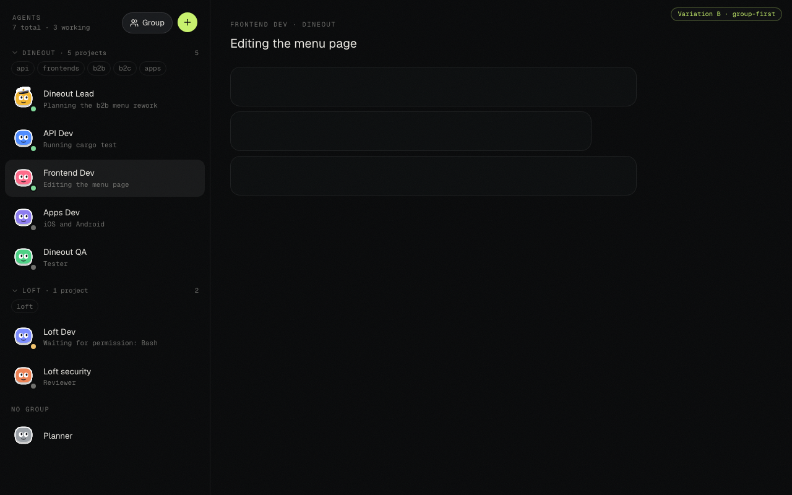
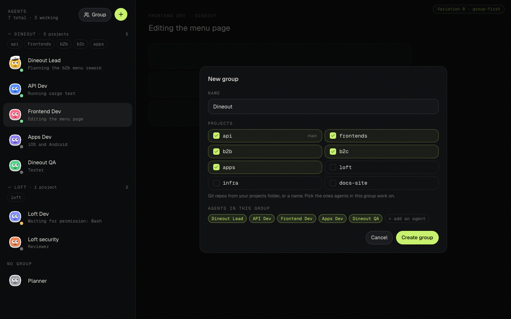
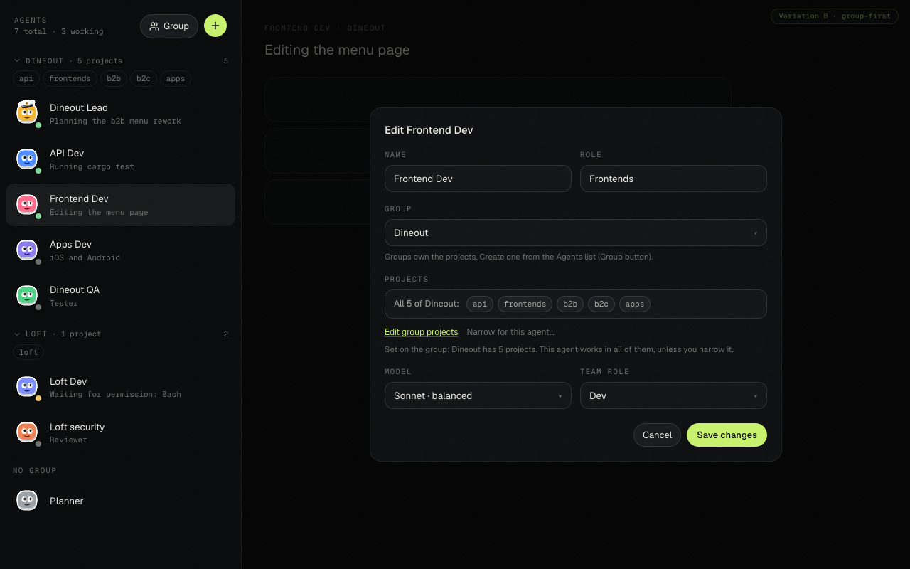
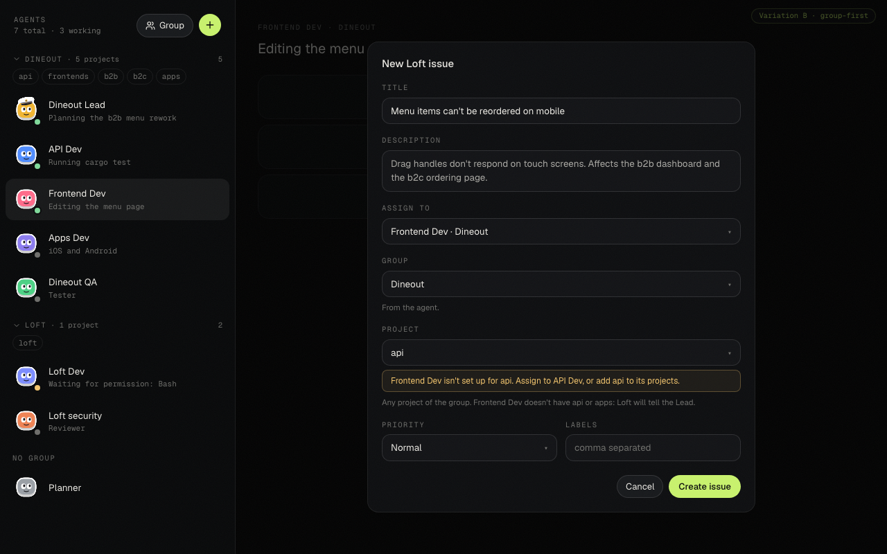

- Pros: one place for "what is Dineout"; adding a repo is one edit; the list header can show the projects; clear ownership.
- Cons: a new entity with its own screen, table, endpoints and events; creating a group before the first agent; the "agent with only 2 of 5" case still needs a per-agent override; more to explain.
- Backend: **L**.

## Variation C: hybrid (recommended)

The group is created **by typing it** on an agent (free text, as the user asked), and it **holds the project list**, edited from the group header in the list (the sliders icon). An agent works in **all of the group's projects by default**, or **only some** (a switch, then chips; the star marks its main one). The issue form shows the agent's projects as chips, with the rest of the group dimmed and one click away (which offers to hand the issue to an agent that has that project).

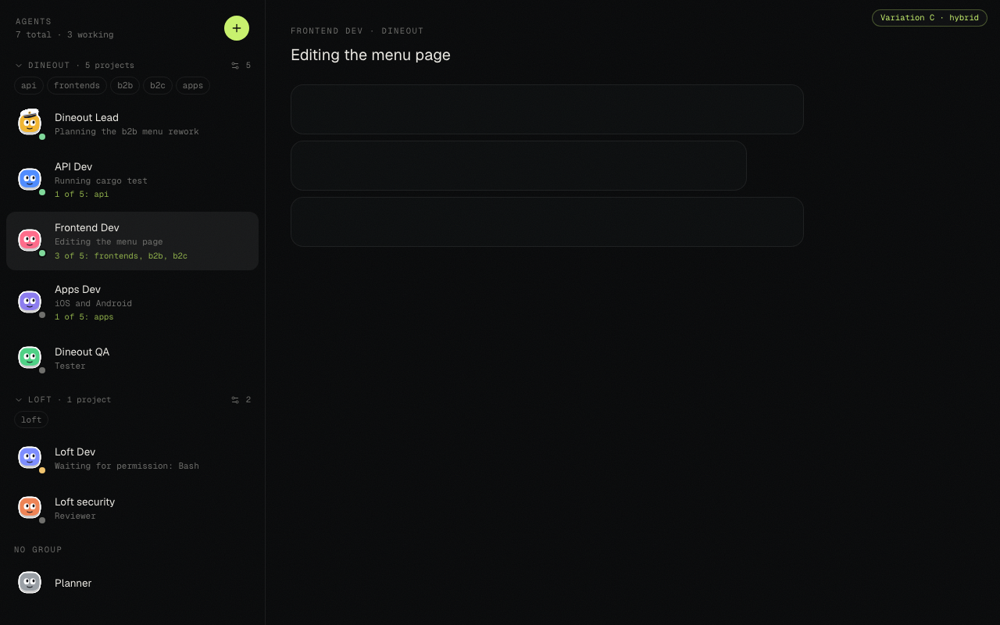
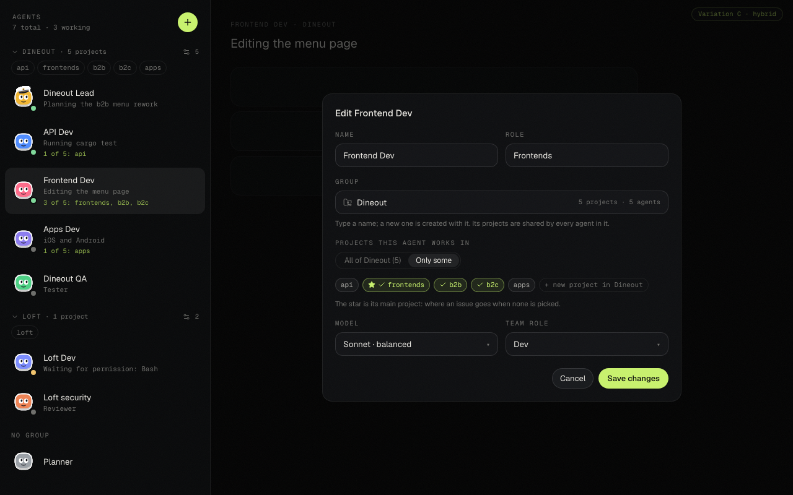
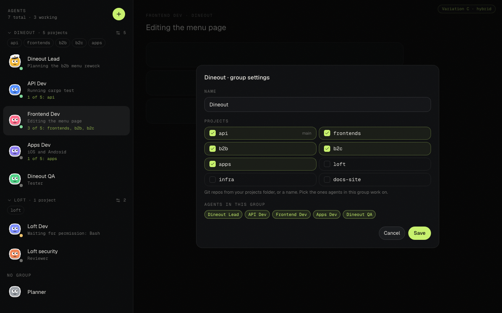
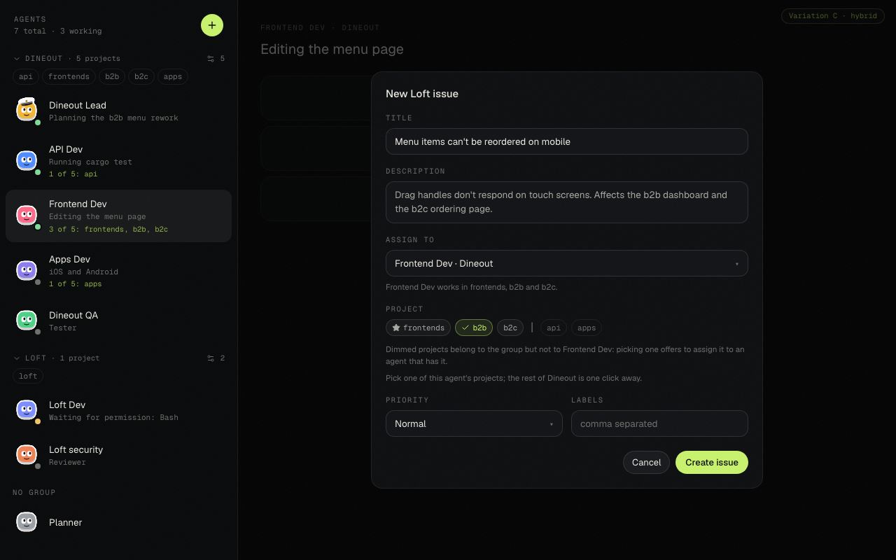

- Pros: the group is free text like today's project (no setup step), yet "what is Dineout" exists in one place; the common case (an agent works across the group) is one click, the exception is a switch; the list shows narrowing only where it matters.
- Cons: two levels of "projects" (the group's and the agent's) to explain; a group row appears implicitly when its first project is added.
- Backend: **M to L** (A plus a small `groups` table: name and project list).

## What changes in the backend (all variations)

| Area | Change |
|---|---|
| Agent fields (`db.rs`, api.rs) | `group` (free text, at most 100 chars, no control chars; never used as a path) and `projects: Vec<String>` (each through `repos::project_name`, so the guards for `..`, absolute and long names stay; de-duplicated, capped at about 20). `project` stays and always equals the main project, so old clients keep working. In B and C, `projects` can be empty, meaning "all of the group's". |
| Migration | For each agent: `group = project`, `projects = [project]`. Agents that shared a project share a group, so **nothing behaves differently until the user changes something**. No data is deleted. |
| The Lead and the team check | One Lead per **group** (today per project); the team check per group. |
| `@mentions` | Chat: same **group** instead of same project (cross-group `@` stays off, as across projects today). Issue threads keep reaching any agent; the picker from #161 groups by group, then "Other agents". Nothing new is allowed between groups. |
| Issues | An issue still has one `project` (one repo). Default = the assignee's main project. A user's issue for a project the assignee doesn't have gets a warning in the thread; an agent creating one (`create_issue`) for a project outside its own is refused, with the list of allowed ones. |
| MCP tools and prompt | The agent is told its group, its projects (main first) and the group's other projects with the agents that have them, so it creates and follows the right repos. `list_agents` shows group and projects. Planning and publishing take an optional `project` (default: main) instead of assuming there is only one. |
| Mirror, sync, greenfield | Sync every project of every agent (de-duplicated), not one per agent. Greenfield keeps working on the main project. |
| `@path` and workspace | The workspace is unchanged. `@path` starts in the main project's folder when there is one project, else in the projects folder. Claude Code can get `--add-dir` for each project folder so the agent can read them. |
| Frontend | The Agents list groups by group; the agent form and New agent dialog get the group and projects controls; New issue limits or dims projects; the Issues project filter is unchanged. |
| B and C only | A `groups` table and `GET/PUT /api/groups`; renaming a group renames it on its agents; deleting one clears the group on its agents. |

## iOS impact (for Loft mobile dev)

`Agent` gains `group: String?` and `projects: [String]?` (optional, so an older server still decodes). `project` stays, equal to the main project, so a build that doesn't know groups keeps working (it groups by main project: finer groups than the user intends until it updates). The Agents and Overview grouping, the @ picker's grouping and the issue-creation project choice move from `project` to `group` + `projects`. In B and C the group's project list comes from `GET /api/groups`.

## Recommendation

**C**, built in two steps: (1) A's backend (agent `group` and `projects`, the migration, the prompt, mentions per group, the issue project rules) with the A-style controls; (2) the group's own project list and the group settings dialog. Step 1 already gives the user what they asked for; step 2 removes the retyping. If the user prefers the smallest change, **A** is a clean first step on the way to C.

## Questions for the user

1. Which way: A (agent-first), B (group-first) or C (hybrid)?
2. Is the migration right: every agent's group = today's project, so nothing changes until you edit?
3. Should agents of **different groups** be able to `@mention` each other in chat? Today different projects can't (issue threads can).
4. When an issue's project is one the assignee doesn't have: only warn (my proposal for your issues), or block? And for agents creating issues (my proposal: block)?
5. One Lead per group, or one per project inside it as today?
6. Does an agent need a "main project" (where an issue goes by default), or should it always be asked?
7. Should groups own a folder (for example `~/dev/dineout` holding the repos), or stay labels?
8. Naming: "group" is fine, or "team" or "workspace"?
